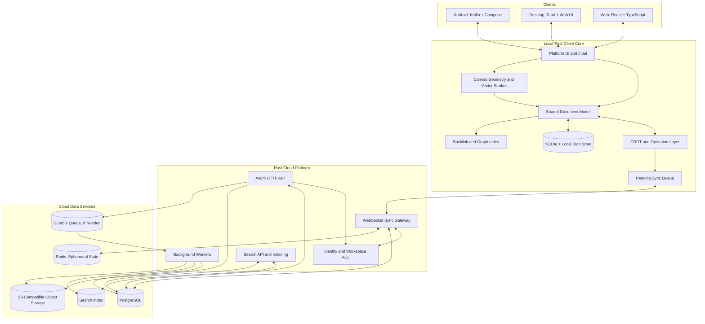
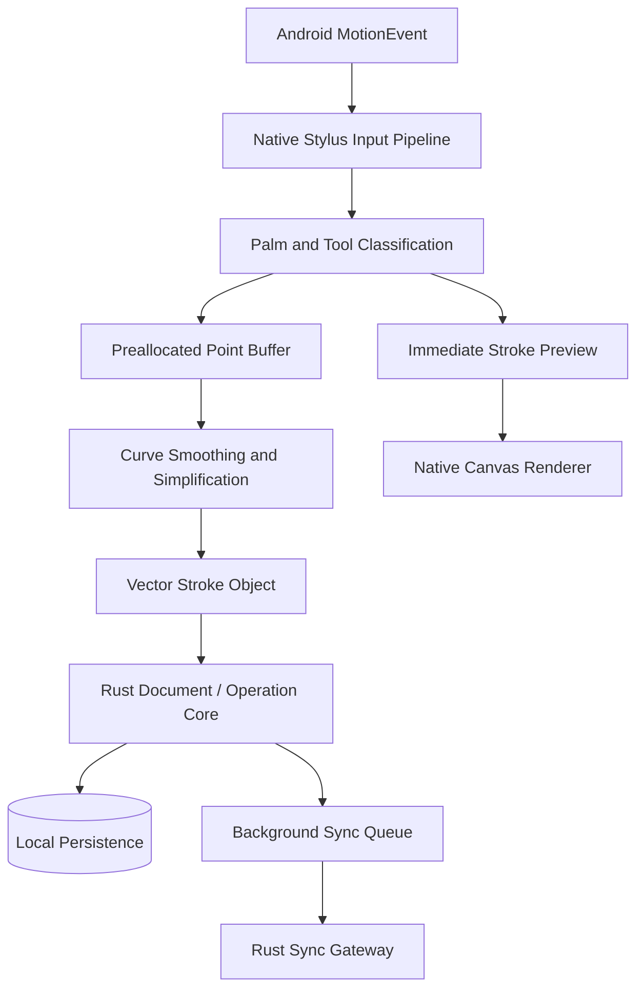
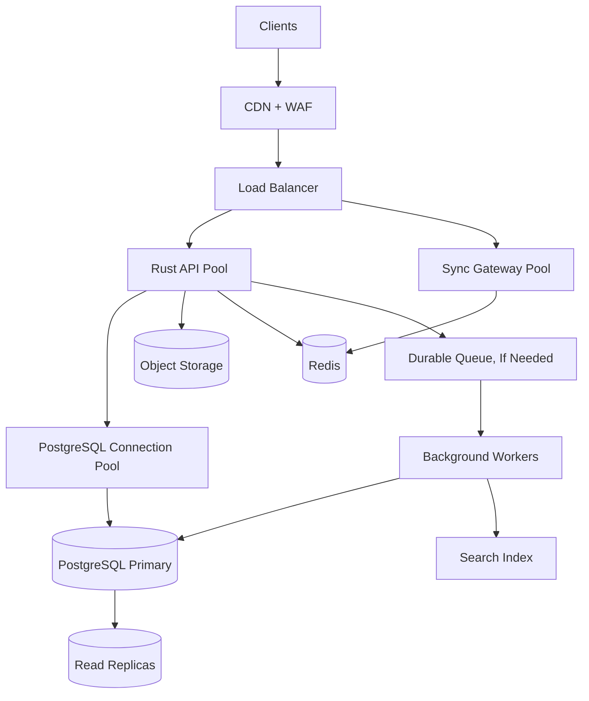

# Vellune — Agent Guide

> **Product name:** Vellune  
> **Tagline:** Where thoughts take form.  
> **Product direction:** A fast, local-first knowledge workspace combining AFFiNE-style documents and infinite canvas with Obsidian-style Markdown, backlinks, and knowledge graphs, plus first-class native Android stylus support.

This file is the working source of truth for AI coding agents and contributors. Follow existing repository conventions where they exist. Treat this document as intended architecture and roadmap, not proof that every component has already been implemented.

---

## 1. Name and product identity

### What Vellune means

**Vellune is an invented brand name**, not an established dictionary word.

- **Vell** evokes *vellum*, a traditional writing material associated with manuscripts and paper.
- **Lune** means *moon* in French.
- **Intended brand association:** a quiet, elegant space where ideas take shape.

**Tagline:** *Where thoughts take form.*

Vellune should feel thoughtful, premium, creative, private, and technically capable. Avoid generic note-app branding. Possible visual motifs: ink strokes, paper, moonlit surfaces, and connected nodes.

Before public launch, check trademarks, domains, GitHub names, package names, and app-store listings. Do not assume the name is legally or digitally available.

## 2. Product vision

Build one personal and collaborative knowledge workspace where people can:

- Write Markdown notes and rich-text documents.
- Connect ideas with `[[wikilinks]]`, backlinks, tags, aliases, and a graph view.
- Create daily notes, templates, folders, and structured collections.
- Draw handwritten notes using native Android stylus input.
- Create infinite whiteboards with strokes, shapes, arrows, sticky notes, diagrams, and embedded pages.
- Mix text, drawings, images, PDFs, code, tables, and tasks in one workspace.
- Work offline, then synchronize safely across devices.
- Import and export portable Markdown and attachments.
- Search documents, backlinks, metadata, and—later—handwriting.
- Collaborate in real time where enabled.
- Keep user data portable and avoid cloud dependence for core editing.

### Product principles

1. **Local-first:** editing must not require a network connection.
2. **Fast by design:** prioritize startup time, input latency, rendering, and efficient storage.
3. **Native Android inking:** pen input must not depend on a WebView.
4. **Portable data:** Markdown import/export must be reliable and documented.
5. **One coherent model:** documents, canvas objects, and drawings should interoperate.
6. **Offline resilience:** interrupted sync must recover without losing acknowledged changes.
7. **Security by default:** enforce workspace access on the server; never trust client-provided permissions.
8. **Measured scalability:** design for growth, but do not add infrastructure without evidence.
9. **Accessible and usable:** support keyboard navigation, touch, stylus, screen readers, and configurable appearance.
10. **Incremental delivery:** ship a tested vertical slice before broad feature expansion.

## 3. Architecture overview

Use a **modular monolith first**. Keep domain modules and APIs separated in code. Deploy one Rust backend initially, with independently scalable workers or sync gateways added when measurements justify them. Do not begin with a fleet of microservices.



### Main request flows

**Writing:** input updates local model → local UI renders → local transaction persists → operation enters sync queue → server authenticates and validates → durable cloud write → other connected clients receive update.

**Drawing:** Android receives stylus samples → native renderer shows immediate preview → samples buffer locally → stroke becomes vector object → local persistence → asynchronous sync batch.

**Opening a page:** load local content immediately → render available content → fetch remote deltas and missing assets in background.

**Attachments:** client requests upload authorization → uploads directly to object storage using signed URL/multipart upload → backend verifies ownership, size, and metadata → attachment reference is committed.

## 4. Recommended technology choices

### Android

- Kotlin
- Jetpack Compose for app UI
- Native Android `MotionEvent` stylus pipeline
- Android Canvas/`View` or a profiled rendering implementation for inking
- JNI for selected Rust core functionality when justified
- SQLite-backed local persistence
- Background sync with appropriate Android lifecycle-aware work scheduling

Keep high-frequency pen input off ordinary Compose recomposition paths. Use native input and rendering. Do not require Rust calls for every point if JNI overhead or memory copies make the path slower; profile first.

### Desktop

- Tauri 2
- React + TypeScript UI
- Rust native core where beneficial
- Local database and blob store
- Native filesystem integration for Markdown vaults, with explicit conflict handling

### Web

- React + TypeScript
- Browser Canvas or WebGL-based renderer as appropriate
- IndexedDB or another suitable local persistence layer
- Same versioned document model and sync protocol where feasible

### Rust backend

- Rust
- Tokio async runtime
- Axum HTTP and WebSocket endpoints
- SQLx for PostgreSQL access
- Serde for serialization
- `tracing` and OpenTelemetry for observability
- `utoipa` or another maintained tool if OpenAPI generation is useful

### Data and infrastructure

- PostgreSQL: durable cloud metadata, permissions, document records, and update persistence
- SQLite: local-first device persistence
- Redis: cache, rate limits, presence, and ephemeral coordination; never sole storage for acknowledged edits
- S3-compatible storage: attachments, images, PDFs, exports, and thumbnails
- PostgreSQL full-text search initially; dedicated search service only when justified
- Durable queue only when asynchronous job volume and reliability needs justify it
- CDN/WAF/load balancer as deployment needs grow

Rust improves control and performance potential, but performance depends on architecture, algorithms, storage, rendering, and network behavior. Benchmark real workloads.

## 5. Suggested monorepo layout

Adapt to the actual repository if one already exists. Avoid moving files or introducing a monorepo rewrite without a clear reason.

```text
vellune/
├── AGENTS.md -> CLAUDE.md        # Agent guide symlink
├── CLAUDE.md                     # Agent guide and instructions
├── README.md                     # Project overview
├── Cargo.toml                    # Rust root workspace
├── package.json                  # Root pnpm dev scripts
├── pnpm-workspace.yaml           # pnpm workspace definition
├── docker-compose-dev.yml        # PostgreSQL & Redis dev containers
├── .env.example                  # Environment configuration template
├── apps/
│   ├── android/                  # Native Android inking (Post-MVP)
│   ├── desktop/                  # Tauri 2 desktop app (React + TS)
│   └── web/                      # Web application (React + TS)
├── crates/
│   ├── domain/                   # Core entities and invariants
│   ├── document/                 # Pages, blocks, document operations
│   ├── editor/                   # Editing transactions and commands
│   ├── crdt/                     # CRDT adapter and merge logic
│   ├── canvas/                   # Geometry, spatial queries, strokes
│   ├── markdown/                 # Markdown parsing/import/export
│   ├── graph/                    # Backlinks, aliases, graph queries
│   ├── search/                   # Search abstractions
│   ├── storage/                  # Persistence abstractions
│   ├── sync-protocol/            # Versioned sync contracts
│   └── api-types/                # Shared API types
├── services/
│   ├── api/                      # Axum HTTP API
│   ├── sync/                     # WebSocket sync service
│   └── workers/                  # Indexing, previews, OCR, exports
├── migrations/                   # PostgreSQL migrations
├── deploy/                       # Docker, deployment, infrastructure
├── development/                  # ALL docs, roadmap, and agent workspace
│   ├── TODO.md                   # Project roadmap and active task lists
│   └── Docs/                     # All documentation (no root docs/ folder)
│       ├── README.md             # Docs index and rules
│       ├── architecture.md       # Spec
│       ├── document-format.md    # Spec
│       ├── sync-protocol.md      # Spec
│       ├── security.md           # Spec
│       ├── adr/                  # Architecture decision records
│       └── notes/                # Working notes, research, benchmarks
└── tests/
    ├── integration/
    ├── sync/
    ├── import-export/
    └── performance/
```

Suggested crate names are proposals. Do not create empty crates for every item at project start. Add modules as real code requires them.

## 6. Canonical document model

Use stable IDs and a versioned canonical model. Markdown is a portability format, not the only possible representation of all workspace features.

Core concepts:

- **Workspace:** ownership, members, permissions, settings.
- **Page:** stable ID, title, metadata, blocks, timestamps.
- **Block:** stable ID, type, payload, ordering/parent relationships.
- **Canvas:** spatial objects with positions, transforms, z-order, and viewport metadata.
- **Stroke:** vector points and brush properties.
- **Link:** explicit page relationship and optional source location.
- **Attachment:** metadata and object-storage key; binary content lives outside the main document row.
- **Operation:** versioned mutation with stable ID and causal metadata where required.
- **Snapshot:** compacted state that allows faster recovery and replay.

Example conceptual page:

```text
Page
 ├── Heading
 ├── RichText
 ├── Checklist
 ├── DrawingBlock
 │    └── VectorStrokes
 ├── ImageAttachment
 ├── CodeBlock
 └── EmbeddedPage
```

### Data format rules

- Stable page IDs must survive rename and move operations.
- File paths map to page IDs; path must not be the permanent identity.
- Preserve frontmatter, wikilinks, tags, aliases, and ordinary Markdown.
- Define deterministic import/export behavior for unsupported rich content.
- Use documented extensions or sidecar metadata for canvas layout and strokes that Markdown cannot represent.
- Version serialized formats and provide migrations.
- Validate all payload sizes and schemas.
- Avoid storing every page as an unbounded JSON blob.
- Keep binary assets out of PostgreSQL rows.
- Do not copy entire documents for every small edit.

## 7. Native Android pen architecture

Native stylus support is a first-class product requirement, not a later web feature.



### Required input behavior

- Pressure-sensitive strokes
- Tilt/orientation where hardware provides it
- Stylus hover and eraser support where available
- Pen, pencil, highlighter, and eraser tools
- Configurable stroke width and color
- Palm rejection and finger gesture policy
- Low-latency preview
- Smooth curves and zoom-independent stroke width policy
- Lasso selection and object transforms
- Undo/redo
- Pan and zoom without accidental marks
- Offline persistence
- Optional raw sample retention for higher-fidelity editing

### Example Rust domain model

Illustrative only; adapt IDs, serialization, precision, and storage to real requirements.

```rust
use uuid::Uuid;

struct Stroke {
    id: Uuid,
    points: Vec<PenPoint>,
    color_rgba: u32,
    base_width: f32,
    tool: PenTool,
}

struct PenPoint {
    x: f32,
    y: f32,
    pressure: f32,
    tilt_x: f32,
    tilt_y: f32,
    timestamp_ms: u64,
}

enum PenTool {
    Pen,
    Pencil,
    Highlighter,
    Eraser,
}
```

### Rendering performance rules

- Show input preview before persistence or network work.
- Keep high-frequency input off expensive UI recomposition paths.
- Minimize allocations and copies in motion callbacks.
- Batch local writes; do not write each point as a separate database transaction.
- Use vector strokes as editable source of truth.
- Use cached raster tiles or layers as derived rendering caches where useful.
- Use a spatial index to query visible objects on large canvases.
- Render only dirty regions when possible.
- Virtualize off-screen content.
- Replace predicted points with actual input once it arrives.
- Benchmark Android Canvas first; adopt OpenGL/Vulkan/custom rendering only if profiling shows need.
- Test on physical stylus devices, not only emulators.

### Drawing interoperability

- Inline drawing blocks can live inside notes.
- Canvas can contain drawings, text blocks, images, shapes, links, and embedded pages.
- Preserve vector data across sync and export.
- PDF annotation should store annotations separately from the original PDF.
- OCR/handwriting recognition should be optional, asynchronous, and never block drawing.

## 8. Obsidian-inspired knowledge features

- Markdown vaults and folders
- `[[wikilinks]]`
- Backlinks and outgoing links
- Tags and nested tags
- Aliases
- YAML frontmatter
- Daily notes
- Templates
- Graph view
- Local full-text search
- Markdown import/export
- External file-change detection
- Broken-link detection and link rename handling

Graph relationships should be indexed separately from page rendering. Large graphs need filtering, progressive loading, and layout computation that does not block typing.

For externally edited Markdown, parse changes and reconcile them. Do not blindly overwrite rich documents when the external representation cannot express all content. Create a recoverable conflict copy when a safe merge is impossible.

## 9. AFFiNE-inspired workspace features

- Rich-text documents with typed blocks
- Infinite canvas and whiteboards
- Sticky notes, shapes, arrows, and connectors
- Embedded pages and links
- Tables and structured collections
- Tasks and checklists
- Images, PDFs, code, bookmarks, and attachments
- Templates
- Workspace sharing and comments
- Real-time collaboration when enabled

Build a coherent shared document model, but allow platform-specific UI and renderers. Do not force every platform into the same rendering implementation.

## 10. Local storage and cloud persistence

### Local device

Use SQLite for structured local records and sync metadata, plus local blob storage for attachments and large payloads. Choose transaction and WAL settings after benchmarking. Keep a recoverable pending-operation queue.

Potential local tables:

```text
local_workspaces
local_pages
local_blocks
local_document_updates
local_snapshots
local_sync_cursors
local_pending_operations
local_attachments
local_search_index
```

Local data must remain usable offline. Define encryption-at-rest requirements based on platform key storage and threat model; do not invent cryptography.

### PostgreSQL

Potential cloud tables:

```text
users
devices
workspaces
workspace_members
pages
blocks
document_updates
sync_checkpoints
page_links
attachments
attachment_references
comments
audit_events
```

Schema should reflect actual access patterns. Use tenant/workspace scoping, foreign keys where appropriate, indexes, constraints, and migrations. Evaluate whether page/block data is relational, JSONB, or a hybrid based on queries and update patterns.

Use transactions for related durable changes. Keep transactions short. Pool connections. Consider partitioning only when data volume and query plans justify it.

### Redis

Appropriate uses:

- Presence and online status
- Rate limiting
- Short-lived cache
- Ephemeral session coordination
- Pub/sub or streams where delivery guarantees are understood

Redis cache loss must not lose acknowledged document edits. Use PostgreSQL or a durable queue/log as source of truth for critical state.

### Object storage

Use S3-compatible storage for large files, thumbnails, imports, exports, PDFs, and media. Upload directly through signed URLs where appropriate. Enforce quotas, file-size limits, MIME validation, access checks, lifecycle policies, and orphan cleanup.

## 11. Sync and collaboration

Prefer a mature CRDT implementation over inventing a custom CRDT. Evaluate Yjs and Rust-compatible options such as `y-octo` for interoperability, maturity, persistence, licensing, mobile integration, and operational behavior before choosing.

### Sync workflow

1. Apply edits locally.
2. Assign stable operation IDs and necessary causal/version metadata.
3. Persist operations and pending queue locally.
4. Send bounded batches with last acknowledged cursor.
5. Authenticate user and validate workspace ACL server-side.
6. Validate schema, payload limits, quotas, and supported protocol version.
7. Persist durable changes before acknowledging them.
8. Fan out updates to authorized connected devices.
9. Reconnect from durable cursor and fetch missing updates.
10. Compact operation history into snapshots safely.
11. Retain sufficient recovery data according to a documented policy.

### Conflict behavior

- Define CRDT semantics for text and collaborative collections.
- Define deterministic behavior for block ordering, deletion, movement, and canvas properties.
- Ensure concurrent stroke creation does not overwrite unrelated strokes.
- Define behavior for simultaneous edits to the same object.
- Test offline concurrent edits across Android, desktop, and web.
- Test duplicate delivery, out-of-order delivery, reconnects, interrupted writes, and schema upgrades.
- Make retries idempotent.
- Do not acknowledge changes before the defined durability guarantee is met.

### WebSocket reliability

- Authenticate connection and authorize every workspace subscription.
- Use heartbeat and idle timeout policy.
- Apply bounded queues and backpressure.
- Limit message size and rate.
- Use exponential reconnect backoff with jitter.
- Support durable cursors and catch-up after disconnect.
- Never assume Redis pub/sub alone provides durable delivery.

## 12. Rust service boundaries

Start with one deployable Rust application and clear internal modules:

- `identity`: OAuth/OIDC, sessions, device management
- `workspace`: membership, roles, ACLs
- `documents`: page and block operations
- `crdt`: merge and validation adapter
- `sync`: cursors, batches, reconnect recovery, fan-out
- `canvas`: geometry, strokes, spatial validation
- `attachments`: upload/download authorization and metadata
- `search`: text index, backlinks, graph queries
- `notifications`: invitations and collaboration events
- `billing`: optional plans and quotas
- `observability`: metrics, logs, traces, audit events

Keep business logic independent from HTTP handlers and database access where practical. Extract a module into a separate service only when load, security boundaries, or deployment needs justify it.

## 13. API design

Use versioned HTTP endpoints for request/response operations and WebSockets for live synchronization.

Example endpoint families:

```text
POST   /api/v1/auth/session
GET    /api/v1/workspaces
POST   /api/v1/workspaces
GET    /api/v1/workspaces/{workspace_id}/pages
POST   /api/v1/workspaces/{workspace_id}/pages
GET    /api/v1/pages/{page_id}
PATCH  /api/v1/pages/{page_id}
DELETE /api/v1/pages/{page_id}
POST   /api/v1/pages/{page_id}/operations
GET    /api/v1/pages/{page_id}/updates?after={cursor}
POST   /api/v1/attachments/upload-url
POST   /api/v1/attachments/complete
GET    /api/v1/search?q={query}
GET    /api/v1/graph/{page_id}
WS     /api/v1/sync
```

These routes are proposals, not an established contract. Document schemas, error responses, pagination, idempotency, auth scopes, and protocol versioning before public release.

## 14. Security and privacy

- Use established OAuth/OIDC flows where appropriate.
- Hash passwords with a suitable modern password-hashing algorithm if local passwords are supported.
- Store secrets in secret managers, never source control.
- Enforce authorization on every server operation and object-storage URL.
- Validate all client input and attachment metadata.
- Apply rate limits, quotas, and abuse controls.
- Use TLS in transit.
- Define session expiry, refresh, revocation, and device logout.
- Protect against cross-workspace data leakage.
- Use audit logs for security-sensitive administrative actions.
- Keep logs free of note content and secrets by default.
- Define backup retention, deletion propagation, and account export.
- Document encryption and recovery model honestly.
- Test IDOR, privilege escalation, malformed CRDT payloads, replay, and upload abuse.
- Do not claim end-to-end encryption unless key management, sharing, search, recovery, and server-side processing all support that design.

## 15. Search and indexing

Start with PostgreSQL full-text search plus indexed tags, metadata, and link edges. Keep indexing asynchronous where it could slow writes.

Search should eventually support:

- Full-text content search
- Title and tag search
- Backlinks and outgoing links
- Filters by workspace, folder, date, and type
- Fuzzy matching if needed
- Optional OCR-derived text

A dedicated search engine is a later scaling option, not a mandatory MVP dependency. Indexes are derived data and must be rebuildable.

## 16. Scale toward one million users

One million registered accounts does not mean one million concurrent users. Define active-user counts, concurrent WebSocket connections, writes/second, average page size, attachment bandwidth, search load, and regional requirements.



### Growth stages

**Stage 1 — MVP**
- One Rust application
- PostgreSQL
- Local-first clients
- Object storage
- Basic Redis only if useful
- Backups, migrations, metrics, error reporting, and tests

**Stage 2 — Growth**
- Multiple stateless API instances
- Connection pooling
- Load balancing
- Background workers and durable jobs where needed
- Signed direct uploads
- Rate limits and idempotency
- Load tests and dashboards

**Stage 3 — Heavy workloads**
- Isolate sync gateways, indexing, OCR, exports, and AI jobs
- Add read replicas where queries benefit
- Tune indexes and connection pools
- Partition large tables based on measured access patterns
- Add dedicated search if needed

**Stage 4 — Regional scale**
- Route clients by region
- Define data residency and failover
- Isolate noisy tenants
- Test regional outages and reconnect storms
- Consider sharding only when simpler designs stop meeting requirements

### Main scale risks

- Long-lived WebSocket connection counts
- PostgreSQL connection exhaustion
- Unbounded CRDT history and replay
- Large attachment bandwidth
- Search indexing lag
- Huge graph views and canvases
- Reconnect storms after outages
- Expensive tenant-level queries
- Background jobs competing with interactive requests

Do not add Kubernetes, Kafka, multiple databases, or microservices solely because target is one million users. Every added system needs an operational reason.

## 17. Performance targets and measurement

These are proposed initial goals; validate on supported hardware and production-like load.

- Local keystroke response: target p95 under 50 ms.
- Pen rendering: target stable 60 FPS on supported devices; evaluate higher refresh-rate screens.
- Local save: no network dependency.
- Common metadata API reads: target p95 under 200 ms under defined test load.
- Sync: recover from durable cursor after reconnect.
- Data durability: no acknowledged cloud edit lost under explicitly defined failure model.
- Startup: establish a measurable budget and test on lower-end supported devices.
- Canvas: render visible objects only; benchmark pages with large stroke/object counts.
- Memory: set budgets for Android and web, then test long editing sessions.
- Sync bandwidth: batch updates and avoid transmitting entire documents for small edits.

Use release-mode benchmarks, realistic datasets, physical Android devices, tracing, flamegraphs, query plans, and load tests. Do not claim these goals are achieved until measured.

## 18. Observability and operations

Use structured logs, metrics, and traces. Monitor:

- API latency and error rates
- WebSocket connections and reconnects
- Sync lag and rejected updates
- PostgreSQL query latency, locks, pool saturation, replication lag
- Redis latency and memory
- Queue depth and worker failures
- Object-storage upload/download errors
- Search indexing lag
- Client crash rate and startup latency
- Android frame time, missed frames, input-to-display latency, memory
- Backup success and restore-test results

Define alerts based on user impact. Never log note contents, access tokens, passwords, or signed URLs.

## 19. Testing strategy

- Unit tests for document invariants, Markdown parsing, link extraction, and canvas geometry.
- Property-based tests for merge and serialization invariants.
- Cross-client sync tests: Android ↔ desktop ↔ web.
- Offline conflict tests with concurrent edits.
- Import/export round-trip tests.
- Fuzz malformed document and sync payloads.
- Database migration tests on realistic fixtures.
- Attachment authorization and quota tests.
- Android stylus instrumentation tests on physical devices.
- UI accessibility tests.
- Load tests for API, sync, PostgreSQL, and reconnect storms.
- Backup/restore drills.
- Security tests for workspace isolation and permission boundaries.

## 20. Development roadmap

### Phase 1 — Local-first notes
- Basic app shell and navigation
- Markdown editor and file organization
- Tags, wikilinks, backlinks, aliases
- Local persistence and search
- Import/export
- Automated tests and performance baselines

### Phase 2 — Native Android pen
- Stylus input pipeline
- Pressure and eraser
- Smooth vector strokes
- Offline drawing persistence
- Undo/redo and lasso
- Notebook UX and canvas performance tests

### Phase 3 — Unified workspace
- Rich-text blocks
- Infinite canvas
- Shapes, connectors, embedded pages
- Tables and structured collections
- Mixed text and drawing blocks

### Phase 4 — Cloud and collaboration
- Identity and workspace ACLs
- PostgreSQL persistence
- Durable sync and reconnect recovery
- Multi-device conflict tests
- Attachment uploads and sharing

### Phase 5 — Production hardening
- Observability
- Load and soak tests
- Backup/restore validation
- Security review
- Quotas and abuse protection
- Scaling and regional-failure plans

A first vertical slice should prove: create note on Android → draw with stylus → save offline → open same note on desktop → sync changes → reconnect after network loss without data loss.

## 21. Agent operating instructions

When working in this repository:

1. Read this file and relevant local instructions before making changes.
2. Inspect the existing codebase before choosing architecture or assuming a module exists.
3. Prefer small, reviewable changes over broad rewrites.
4. Keep Rust domain logic independent from UI and transport where practical.
5. Keep Android stylus capture native and latency-sensitive.
6. Never put network calls in the immediate pen-rendering path.
7. Preserve local-first behavior and never make typing depend on cloud availability.
8. Treat document format and sync protocol as versioned contracts.
9. Add tests for data migration, conflict handling, and serialization changes.
10. Never silently discard user content during migration or import.
11. Do not introduce new infrastructure without explaining the requirement and operational cost.
12. Measure before optimizing or claiming performance gains.
13. Never commit credentials, tokens, production data, or secrets.
14. Update specs in `development/Docs/` and add an ADR in `development/Docs/adr/` when a significant design choice changes.
15. State assumptions and tradeoffs in pull requests or implementation summaries.
16. Run relevant formatting, linting, tests, and build checks; report failures accurately.
17. Do not claim a feature is complete unless implemented and verified.
18. Keep compatibility, accessibility, security, and recovery in scope—not as post-launch cleanup.

## 22. Definition of done

A feature is not done until:

- Acceptance behavior is implemented.
- Relevant tests pass.
- Data migrations and backward compatibility are addressed.
- Offline and failure behavior is defined where relevant.
- Security and authorization are tested for cloud operations.
- Performance is measured for latency-sensitive features.
- Accessibility and platform behavior are checked.
- Documentation is updated.
- Known limitations are recorded honestly.

---

## Final architectural direction

**Vellune = local-first knowledge workspace + native ink + connected thinking.**

Build fast local editing and reliable data foundations first. Add rich workspace features and cloud collaboration incrementally. Treat native Android stylus support as a core differentiator, not a wrapper around web drawing.


## For AI Agents

- **All documentation lives in `development/` — there is no root `docs/` folder.** Do not create one; do not write docs anywhere else.
  - Roadmap and task checklists: [`development/TODO.md`](development/TODO.md). Tick tasks off as they land.
  - Canonical specs: [`development/Docs/`](development/Docs) — `architecture.md`, `document-format.md`, `sync-protocol.md`, `security.md`. Code that changes a contract updates its spec in the same commit.
  - Architecture decision records: `development/Docs/adr/NNNN-short-title.md`. Supersede, never rewrite, an accepted ADR.
  - Working notes, research, benchmarks, scratchpads: `development/Docs/notes/` (create on first use).
  - Index and rules: [`development/Docs/README.md`](development/Docs/README.md).
  - You are free to create any `.md` file inside `development/` to support your task execution.
- **Product scope:** Feature parity target is [AFFiNE](https://github.com/toeverything/affine) (docs + edgeless whiteboard + databases) plus Obsidian-style knowledge features (wikilinks, backlinks, interactive graph view) and an MCP server so AI agents can read and write a workspace. See the matching milestones in `development/TODO.md`.
- **MVP Focus Policy:**
  - For the MVP, active development focuses on the **Desktop application (Tauri 2)** and the **Web application (React + TS)** alongside the Rust core services.
  - Native Android stylus inking (`apps/android`) is scheduled for Phase 2 (post-MVP).
- **Updating CLAUDE.md:**
  - You have full permission to keep `CLAUDE.md` updated with accurate project conventions and instructions.

## Development Commands

- `pnpm dev`: Start the backend API (which also serves the WebSocket sync gateway at `/api/v1/sync`) and the web client. Vite proxies `/api` to `127.0.0.1:8080`. Run `pnpm db:up` first.
- `pnpm dev:backend`: Run the Axum HTTP API service (`cargo run -p vellune-api`).
- `pnpm dev:sync`: Placeholder binary; live sync currently runs inside `vellune-api` (ADR 0002).
- `pnpm dev:workers`: Run the background workers (`cargo run -p vellune-workers`).
- `pnpm dev:web`: Run the web frontend dev server via Vite (`pnpm --filter @vellune/web dev`).
- `pnpm dev:desktop`: Run the desktop client dev environment (`pnpm --filter @vellune/desktop dev`).
- `pnpm db:up`: Start PostgreSQL 16 & Redis 7 via Docker Compose (`docker compose -f docker-compose-dev.yml up -d`).
- `pnpm db:down`: Stop local dev database containers (`docker compose -f docker-compose-dev.yml down`).
- `cargo check`: Verify compilation across all Rust workspace crates and services.
- `pnpm --filter @vellune/ui test`: UI unit tests (model, Markdown, links, E2E crypto, Yjs merge).
- Admin panel: `http://localhost:3000/admin`. There is no separate admin password: sign in with a normal account that has `is_admin`. The first account registered on a fresh database is admin automatically; admins can promote others in the panel's Users tab. Locked out: `UPDATE users SET is_admin = true WHERE email = '<email>';` via `docker compose -f docker-compose-dev.yml exec postgres psql`.
- Organize tree selection: Ctrl/Cmd+click toggles, Shift+click selects a range, Shift+Arrows extends, Ctrl+A selects all, Delete/Backspace moves the selection to trash, Esc clears. Right-click on a multi-selection offers bulk trash.

## Commit Guidelines

- All commits should follow the conventional commit format: `<type>(<scope>): <subject>` where `type` is one of:
  - `feat`: A new feature
  - `fix`: A bug fix
  - `docs`: Documentation only changes
  - `style`: Changes that do not affect the meaning of the code (white-space, formatting, etc.)
  - `refactor`: A code change that neither fixes a bug nor adds a feature
  - `perf`: A code change that improves performance
  - `test`: Adding missing tests or correcting existing tests
  - `chore`: Maintenance, dependencies, workspace config
- The `scope` is optional and identifies the module or area touched (e.g. `workspace`, `domain`, `api`, `desktop`, `web`).
- **Important for AI Agents:** Never add yourself or any AI attribution as a co-author. All commit messages must be co-author free.  