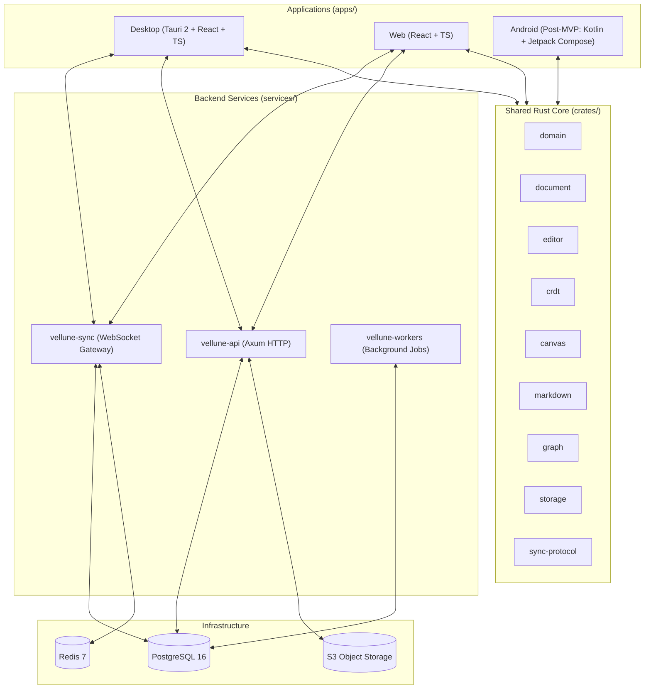

<div align="center">

# Vellune

**Where thoughts take form.**

A fast, local-first knowledge workspace combining block-based documents and an infinite whiteboard canvas with Obsidian-style Markdown, connected `[[wikilinks]]`, and knowledge graphs.

[](LICENSE)
[](https://www.rust-lang.org/)
[](https://tauri.app/)
[](https://react.dev/)
[](docker-compose-dev.yml)

</div>

---

## 🌟 Vision & Principles

Vellune is designed for thinkers, researchers, and creators who need a unified space for structured prose, unstructured spatial thinking, and connected ideas—without sacrificing speed, privacy, or data ownership.

- **Offline-First & Sovereign:** Read, write, and organize offline with zero network dependency. Your data stays in local SQLite databases and portable Markdown vaults.
- **Connected Thinking:** Bidirectional `[[wikilinks]]`, backlinks, tags, aliases, and visual graph exploration.
- **Unified Canvas & Document Engine:** Rich-text blocks, shapes, sticky notes, embedded pages, and vector ink strokes in one coherent, versioned data model.
- **Conflict-Free Collaboration:** Powered by CRDTs (Conflict-free Replicated Data Types) and causal vector clocks for deterministic sync across devices.
- **Native Stylus Inking (Post-MVP):** High-frequency, low-latency pen input tailored for hardware stylus devices.

---

## 🗺️ MVP Roadmap & Focus

> [!IMPORTANT]
> **Active MVP Focus:** Development is currently focused on shipping the **Desktop App (Tauri 2)** and **Web App (React + TS)** alongside the Rust backend platform.
> Native Android inking with Jetpack Compose (`apps/android`) is scheduled for Phase 2.

See [`development/TODO.md`](development/TODO.md) for the active task checklist and milestone tracker.

---

## 🏗️ Architecture Overview

Vellune is structured as a **modular monolith** with clean crate boundaries:



### Monorepo Structure

```text
vellune/
├── apps/
│   ├── desktop/                  # Tauri 2 native desktop app (React + TS)
│   ├── web/                      # Browser web application (React + TS)
│   └── android/                  # Native Android inking app (Post-MVP)
├── crates/
│   ├── domain/                   # Core entities (Workspace, Page, Block, Stroke)
│   ├── document/                 # Canonical document model & block tree
│   ├── editor/                   # Transactions, editor commands, undo/redo
│   ├── crdt/                     # CRDT adapters and causal merge logic
│   ├── canvas/                   # Geometry, bounding boxes, spatial queries
│   ├── markdown/                 # Markdown parsing, AST, and [[wikilink]] extraction
│   ├── graph/                    # Backlink indices, forward links, tag index
│   ├── search/                   # Search query interfaces & scoring traits
│   ├── storage/                  # SQLite & PostgreSQL persistence abstractions
│   ├── sync-protocol/            # Versioned WebSocket sync wire contracts
│   └── api-types/                # Shared REST DTOs and payloads
├── services/
│   ├── api/                      # Axum HTTP REST API
│   ├── sync/                     # WebSocket real-time sync service
│   └── workers/                  # Async background worker tasks
├── development/                  # Active developer & AI workspace
│   ├── TODO.md                   # Task roadmap and milestone checklists
│   └── Docs/                     # All project documentation
│       ├── architecture.md       # System design and request lifecycle
│       ├── document-format.md    # Canonical data models & block types
│       ├── sync-protocol.md      # WebSocket protocol specification
│       ├── security.md           # Tenant isolation, RBAC, and crypto principles
│       ├── adr/                  # Architecture Decision Records (ADRs)
│       └── notes/                # Working implementation notes & research
├── migrations/                   # PostgreSQL database migrations
├── docker-compose-dev.yml        # PostgreSQL 16 & Redis 7 development containers
├── package.json                  # Root pnpm development scripts
└── Cargo.toml                    # Root Rust workspace manifest
```

---

## 🚀 Getting Started

### Prerequisites

- **Rust:** `1.80+` (`rustup update stable`)
- **Node.js:** `20+` or `22+`
- **pnpm:** `9+` or `12+` (`npm install -g pnpm`)
- **Docker & Docker Compose:** for local PostgreSQL and Redis

### 1. Clone & Install Dependencies

```bash
git clone https://github.com/vellune/vellune.git
cd vellune

# Install JS dependencies across workspaces
pnpm install
```

### 2. Configure Environment & Start Databases

```bash
# Copy sample environment configuration
cp .env.example .env

# Start local PostgreSQL 16 and Redis 7 containers
pnpm db:up
```

### 3. Start Development Services

You can spin up all development services with a single command:

```bash
# Starts backend API, WebSocket sync, and Web frontend concurrently
pnpm dev
```

Or run targeted services individually:

| Command | Description |
|---|---|
| `pnpm dev:backend` | Runs the Axum HTTP REST API (`cargo run -p vellune-api`) |
| `pnpm dev:sync` | Runs the WebSocket live sync gateway (`cargo run -p vellune-sync`) |
| `pnpm dev:workers` | Runs the background worker engine (`cargo run -p vellune-workers`) |
| `pnpm dev:web` | Starts the Vite web client on `http://localhost:3000` |
| `pnpm dev:desktop` | Starts the Tauri desktop client dev environment |
| `pnpm db:logs` | Streams logs from PostgreSQL & Redis containers |
| `pnpm db:down` | Stops the local development containers |
| `cargo check` | Verifies compilation of all Rust crates and services |

---

## 📖 Documentation

Detailed architectural and technical specifications are available in [`development/Docs/`](development/Docs):

- [**System Architecture**](development/Docs/architecture.md): High-level topology, request lifecycles, and component interactions.
- [**Document Format Specification**](development/Docs/document-format.md): Blocks, vector stroke coordinates, and Markdown round-trip rules.
- [**Sync Protocol**](development/Docs/sync-protocol.md): Wire format, causal clocks, WebSocket lifecycle, and recovery.
- [**Security & Privacy**](development/Docs/security.md): Tenant isolation, RBAC, presigned uploads, and data protection.
- [**Architecture Decision Records (ADRs)**](development/Docs/adr/0001-modular-monolith-and-rust-core.md): Formal design rationales.

---

## 🤝 Contributing & Commits

We welcome contributions from the community! Please ensure all code passes formatting, type checking, and tests:

```bash
cargo check
pnpm build
```

### Commit Guidelines

Commits must follow the [Conventional Commits](https://www.conventionalcommits.org/) specification:

```text
<type>(<scope>): <subject>
```

- Types: `feat`, `fix`, `docs`, `style`, `refactor`, `perf`, `test`, `chore`
- Scope: optional module name (`workspace`, `api`, `desktop`, `web`, `markdown`, etc.)
- Example: `feat(markdown): support wikilink alias syntax [[Target|Label]]`

---

## 📄 License

Vellune is licensed under either of:
- Apache License, Version 2.0 ([LICENSE-APACHE](LICENSE-APACHE) or http://www.apache.org/licenses/LICENSE-2.0)
- MIT license ([LICENSE-MIT](LICENSE-MIT) or http://opensource.org/licenses/MIT)

at your option.
