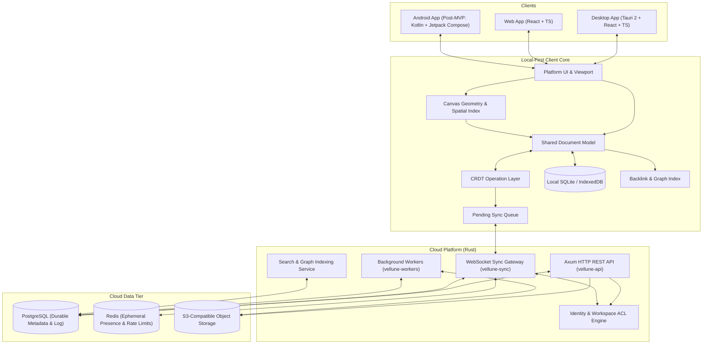

# Vellune Architecture Overview

> **Product:** Vellune — Where thoughts take form  
> **Core Direction:** Fast, local-first knowledge workspace combining document blocks, infinite canvas, connected Markdown graphs (`[[wikilinks]]`), and cross-platform synchronization.

---

## 1. High-Level System Architecture

Vellune is structured as a **modular monolith** with clear architectural boundaries between clients, local storage, backend services, and data layers.

---

## 2. Architectural Principles

1. **Local-First & Offline Resilience:** Core reading, writing, and canvas editing execute against the local embedded database (SQLite on Desktop, IndexedDB on Web) with zero network dependency. Edits are queued and synced asynchronously.
2. **Modular Monolith First:** Domain logic lives in decoupled Rust crates (`crates/*`). Backend services deploy initially as a cohesive service group rather than fragmented microservices.
3. **Single Canonical Document Model:** Document text, typed blocks, whiteboard nodes, and vector strokes share coherent identity and causal ordering primitives.
4. **Desktop & Web Priority (MVP):** MVP focuses on stabilizing the desktop experience (Tauri 2) and web client alongside the Rust backend. Native Android inking is scheduled for Phase 2.
5. **Security by Default:** All workspace boundaries and resource accesses are verified server-side with strict ACLs; client assertions are never trusted unconditionally.

---

## 3. Monorepo Crate & Service Organization

| Path | Purpose |
|---|---|
| `crates/domain` | Core domain entities (Workspace, Page, Block, Stroke, PenPoint) |
| `crates/document` | Canonical document model, block hierarchies, and tree operations |
| `crates/editor` | Transaction management, editor commands, undo/redo stacks |
| `crates/crdt` | CRDT merge logic, causal clocks, and delta serialization |
| `crates/canvas` | Infinite canvas geometry, bounding boxes, spatial queries |
| `crates/markdown` | Markdown parsing, frontmatter parsing, `[[wikilink]]` extraction |
| `crates/graph` | Bidirectional backlink indices, forward links, and tag graphs |
| `crates/search` | Search traits, query parsing, and relevance scoring |
| `crates/storage` | Document repository and blob store persistence traits |
| `crates/sync-protocol` | Versioned WebSocket wire contracts (Client/Server messages) |
| `crates/api-types` | REST request/response DTOs shared across modules |
| `services/api` | Axum HTTP REST server (Workspaces, Pages, Auth, Attachments) |
| `services/sync` | High-performance WebSocket gateway for real-time collaborative sync |
| `services/workers` | Background processing (indexing, thumbnails, export generation) |
| `apps/desktop` | Tauri 2 native desktop application wrapper |
| `apps/web` | React + TypeScript web application |
| `apps/android` | Native Android application (Post-MVP) |

---

## 4. Key Request & Data Flows

### Local Mutation & Sync Queue Flow
1. User types in a note or manipulates a canvas node.
2. The UI applies the change to the local in-memory model and commits to local SQLite/IndexedDB.
3. The mutation is recorded as a CRDT operation with a stable causal sequence.
4. The operation enters the pending sync queue.
5. When online, the sync client streams batched operations over WebSocket to `vellune-sync`.
6. The server validates workspace authorization, applies updates to PostgreSQL, and broadcasts deltas to other active peers.

### Attachment Upload Flow
1. Client requests an upload URL from `POST /api/v1/attachments/upload-url` with file size and MIME type.
2. `vellune-api` verifies workspace storage quotas and user write permissions.
3. Server returns a presigned S3 upload URL.
4. Client uploads the binary payload directly to S3-compatible storage.
5. Client confirms upload via `POST /api/v1/attachments/complete`, committing the attachment reference to the document.
