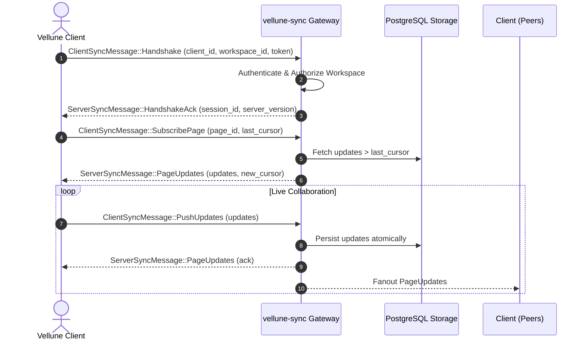

# Vellune Synchronization Protocol

> **Specification:** Version 1.0  
> **Transport:** WebSocket (`/api/v1/sync`) + HTTP Delta Polling (`/api/v1/pages/{id}/updates`)

---

## 1. Overview

The Vellune sync engine coordinates conflict-free document and canvas state propagation across offline devices. It follows a **causal log with bounded cursors** model backed by CRDT operations.

---

## 2. Session Lifecycle & Handshake

Connecting clients initiate synchronization via a JSON handshake message over a secure WebSocket connection:

---

## 3. Wire Message Schema

### Client Messages (`ClientSyncMessage`)
- `Handshake`: Establishes protocol compatibility and authentication credentials.
- `SubscribePage`: Requests live subscription to a document or canvas channel with optional catch-up cursor.
- `PushUpdates`: Sends batched CRDT operation deltas to the server.
- `Heartbeat`: Periodic ping to detect stalled TCP connections (interval: 30s).

### Server Messages (`ServerSyncMessage`)
- `HandshakeAck`: Confirms successful handshake and assigns active session ID.
- `PageUpdates`: Streams remote updates with updated monotonic causal cursor.
- `HeartbeatAck`: Echo acknowledgment of client ping.
- `Error`: Standardized error envelope (`code`, `message`).

---

## 4. Conflict Resolution & Idempotency

1. **State-based / Delta-based CRDTs:** Text editing and collaborative collections converge deterministically regardless of message delivery order.
2. **Stable Operation IDs:** Every mutation carries a unique UUID and client clock (`(client_id, sequence)`). Duplicate delivery across network reconnects is dropped idempotently.
3. **Cursor Recovery:** Clients persist the latest acknowledged cursor (`SyncCursor`) in local SQLite. On reconnection after offline periods, clients resume exactly from where they left off.
4. **Durability Guarantee:** Operations are acknowledged to the sending client only after being committed to durable cloud PostgreSQL storage.
